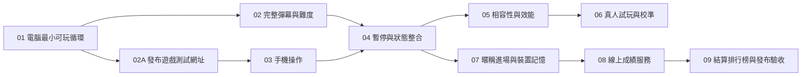

# 遊戲開發工作單規劃

狀態：原始遊戲工單沿用既有進度；2026-11-06 已完成排行榜需求訪談，追加工單 07–09；07 已驗收，08 服務已實作並部署，09 已實作，待發布與實機驗收。原始拆分日期：2026-10-31。

依據：[遊戲規格](game-spec.md)與[遊戲用語表](../GLOSSARY.md)。本文件用於審閱規劃，不是正式工作單清單，也不代表已開始實作。確認後，每張工作單須各自建立為一筆議題或一份檔案。

## 流程與範圍

採用 `ask-matt` 所指引的 `to-tickets` 流程，將現有規格拆為可展示、可驗證的完整行為。已有定稿遊戲規格，本輪直接以該規格作為拆分依據。

初次規劃時儲存庫只有規格、用語表與專案指引；截至本次追加規劃，已有 TypeScript／Vite 遊戲及測試。工作單系統尚未設定；遠端儲存庫為 `Davisanity-TW/kingOfFlak`，建議使用該儲存庫的 GitHub Issues，也可選本機 Markdown 工作單。正式建立前，依 `setup-matt-pocock-skills` 完成存放位置與相關設定確認。

原始規劃交付可在本機啟動及建置的單人遊戲，包含供跨裝置測試的公開網址，不包含帳號、射擊、道具或音效。2026-11-06 追加暱稱進場與共同排行榜，已確認設計與工單見文末；07 已實作，線上排行榜待 08–09。技術選型與可重現的開發指令由第一張工作單落實，不另拆一張只做架構或工具安裝的任務。

## 工作單總覽

| 編號 | 工作單 | 直接前置依賴 | 完成後可展示的成果 |
| --- | --- | --- | --- |
| 01 | 電腦版最小可玩循環 | 無 | 開始、方向鍵移動、遭子彈命中、結算及重玩。 |
| 02 | 完整追蹤彈幕與難度時間表 | 01 | 隨機生成、追蹤、反彈、60 至 300 顆及定時加速均實際影響遊戲。 |
| 02A | 發布遊戲測試網址 | 01 | 手機可透過公開 HTTPS 網址開啟遊戲，不依賴本機伺服器。 |
| 03 | 手機橫向畫面與類比搖桿 | 02A | 手機可用搖桿完成同一局遊戲，地圖不被操作區遮擋。 |
| 04 | 暫停、恢復與跨裝置狀態整合 | 02、03 | 手動暫停、失焦及轉向可安全恢復，成績與難度計時一致。 |
| 05 | Chrome／Safari 相容性與效能驗收 | 04 | 完整遊戲在指定裝置有可追溯的驗證結果，發現的問題已修正。 |
| 06 | 真人試玩與平均存活時間校準 | 05 | 有電腦、手機分開統計的試玩結果，據此驗證或調整至平均 20–30 秒。 |
| 07 | 暱稱進場、版本後綴與裝置記憶 | 04 | 電腦與手機輸入暱稱後遊玩，下次開啟自動帶入；所有開始入口一致。 |
| 08 | 線上休閒榜成績收錄與查詢 | 07 | 兩台裝置透過服務收錄獨立局次，取得排序一致的共同前 20 名。 |
| 09 | 結算排行榜、弱網處理與發布驗收 | 08 | 死亡後自動上傳與顯示榜單，離線明確提示且可立即重玩。 |

01 完成後可進行 02 與 02A；02A 必須在開始 03 前完成。兩者仍共用遊戲狀態與輸入介面，實際同時實作時須協調共用部分。其餘依箭頭順序處理。本規劃不會自動啟動平行實作。

## 01：電腦版最小可玩循環

**交付行為：** 玩家能在電腦開啟遊戲、開始一局、操控飛機閃避可移動的測試子彈，碰撞後查看成績並重玩。這是可運作的第一段遊戲，不是只有靜態畫面。

**狀態：** 已完成。2026-10-31 使用者確認工單 01 全數驗證完成（MacBook／Chrome）；瀏覽器版本未提供。8 項單元測試、3 項 Chrome 瀏覽器測試、型別檢查與建置通過。實作提交：`9b061bb`；首幀凍結修正：`9477d33`。

**前置依賴：** 無。

**規格涵蓋：** Q1–Q3、Q6、Q7 的地圖與飛機參數、Q10 的鍵盤操作、Q12 的視覺，以及結算與重新開始。

**驗收條件：**

- [x] 建立必要工具鏈、格式與靜態檢查；提供相依套件安裝、本機啟動、自動化測試及正式建置的可重現指令，記錄語言、框架、進入點及實際目錄結構，排除產物與本機機密。
- [x] 800 × 600 地圖以 4:3 完整等比例顯示；深色地圖、淺色飛機、橘色圓點子彈，時間與數量位於地圖外。按鈕可使用鍵盤操作並有明確焦點與名稱。
- [x] 飛機從中央開始，輪廓約 20 × 20、最高速度每秒 240；方向鍵直接移動，上＋右可斜移且不加速，相反方向抵銷，鬆開即停，機頭固定朝上，貼牆可沿牆移動且不越界。
- [x] 先用少量可重現的移動子彈完成整個遊玩循環，明確標記為本階段開發情境；完整正式生成規則由 02 取代，不能將少量情境視為最終玩法。
- [x] 圓形子彈與可見機身、機翼接觸或相切即結束，透明角落不算；較大的單次移動跨過飛機仍可偵測命中。
- [x] 結算凍結畫面並標示致命接觸位置，只顯示死亡當下子彈數及存活秒數到小數點後一位；致命子彈計入，多顆同時命中只結算一次。
- [x] 重玩會重設位置、時間、子彈與輸入，結算後數字保持不變，沒有歷史紀錄或額外總分。
- [x] 自動化驗證斜移、鬆開、邊界、碰撞輪廓、高速穿越及結算重設；實際在瀏覽器完成一次開始至重玩的操作，附驗證結果。

**測試邊界：** 從輸入方向與經過時間驗證遊戲狀態，再以瀏覽器驗證畫面與操作是否接上同一行為。測試可控制子彈初始狀態，不需要為測試新增玩家可見選項。

## 02：完整追蹤彈幕與難度時間表

**交付行為：** 玩家面對開局全地圖隨機、後續四周生成的正式彈幕；子彈會追蹤及反彈，數量與速度按時間增加，並沿用既有碰撞與結算。

**狀態：** 依最新規格修訂實作中。19 項遊戲狀態測試、型別檢查、格式檢查與正式建置通過；本機 Chrome 操作測試因瀏覽器啟動崩潰尚未重驗，真人平衡與跨裝置驗收仍由 05、06 處理。

**前置依賴：** 01。

**規格涵蓋：** Q4–Q5、Q7–Q9、Q14、難度時間表及成績定義。

**驗收條件：**

- [x] 開局 60 顆，每 5 秒加入 20 顆，最多 300 顆；子彈半徑 4，持續存在且彼此穿透，數量不足時只補至上限。
- [x] 開局 60 顆於全地圖隨機生成，中心距飛機起始點至少 80 單位；後續增量從四周隨機生成，均無預警且完全位於地圖內。初始朝向起始位置。
- [x] 80 單位安全區只適用開局 60 顆；後續子彈從四邊隨機生成，照常按時增加，不延後加速排程。
- [x] 子彈開局速度每秒 60，第 5 秒首次增加每秒 20，前 5 秒不追蹤，第 5 秒起以每秒最多 12 度逐漸轉向當下飛機，不預判；撞牆依鏡面反射、速率不變，同時撞兩面牆反轉兩個速度分量，反射方向不被追蹤立即覆蓋。
- [x] 開局速度每秒 60，第 5 秒首次增加每秒 20，第 5 秒增為 80，之後每 5 秒增加 20，最高 300；新舊子彈都使用當下速率，生成與加速同時到期時先加速再生成。
- [x] 沒有跳過生成時，第 5 秒為 80 顆／速度 80，第 25 秒為 160 顆／速度 160，第 60 秒為 300 顆／速度 300。超過 30 秒及達上限後都可繼續遊玩。
- [x] 變更畫面更新率或一次跨過多個排程時點，不會漏生、重複加速或改變有效時間下的規則；重玩重設所有排程及速度。
- [x] 自動化驗證出生安全、數量上限、加速邊界、追蹤角度、牆與角落反射，以及最高速度的碰撞；在正式玩法中展示數量、速度與結算一致。

**測試邊界：** 沿用 01 的遊戲狀態行為測試，加入可控制的時間與隨機結果；驗證玩家看得到的彈道、數量及成績，不另建通用遊戲引擎。

## 02A：發布遊戲測試網址

**交付行為：** 提供手機可直接開啟的公開 HTTPS 遊戲網址。保留既有編號，本單必須在開始工單 03 前完成。

**狀態：** 部署流程已備妥；待推送授權、啟用 GitHub Pages、公開網址驗證與真實手機驗收，尚未完成。

**前置依賴：** 01；可先發布少量子彈開發情境，不必等待 02。

**驗收條件：**

- [x] 將正式建置產物發布至靜態託管服務，交付實際 HTTPS 網址；不可用 localhost、區域網路位址或原始碼網址代替。
- [x] 開發伺服器關閉後仍可使用，不要求手機與電腦使用相同 Wi-Fi，不使用短期開發隧道作為固定測試入口。
- [x] 從發布網址確認頁面、程式與樣式正常載入，重新整理正常；電腦可完成開始、移動、碰撞、結算與重玩。
- [x] 至少以一台真實手機開啟網址，記錄裝置、瀏覽器與載入結果；搖桿操作由 03 交付。
- [x] README 記錄實際測試網址、託管方式、部署及更新指令、已發布的 Git commit。後續工單驗收前更新發布版本。
- [x] 設定必要的資源路徑與部署流程；憑證放在服務或 CI 的機密設定，不寫入版本控制。

**外部條件：** 需要部署權限與真實手機驗證結果。未完成時不得標記完成或開始 03；實際網址於交付時填入。

## 03：手機橫向畫面與類比搖桿

**交付行為：** 玩家可在手機橫向使用右側搖桿開始、操控飛機、死亡並重玩，使用與電腦相同的地圖及規則。

**前置依賴：** 02A（已包含 01）；開始前須取得已驗證的公開測試網址。可使用少量子彈情境驗收操作，不依賴 02 的完整彈幕。

**規格涵蓋：** Q1、Q10 的手機操作、Q13 的手機版面與全螢幕降級體驗。

**驗收條件：**

- [ ] 介面填滿可用橫向畫面，4:3 地圖保持完整、不拉伸、不裁切；搖桿與資訊在地圖外，窄螢幕可縮小整張地圖，至少檢查 640 × 360 可用區域。
- [ ] 固定右側類比搖桿的中央 15% 為死區，其外立即以固定每秒 240 移動，無加減速或慣性；支援連續方向、鬆開即停。
- [ ] 手指移出搖桿範圍、觸控取消或第二根手指觸碰介面時，原操作不會卡住或被意外接管；遊戲操作不觸發頁面捲動。
- [ ] 開始、結算與重玩可觸控操作；搖桿有可辨識的用途說明，控制區與系統安全區不互相遮擋。
- [ ] 開始操作可觸發全螢幕請求，無法進入時仍可在橫向瀏覽器正常遊玩；直向顯示橫放提示，不開始新局。遊戲中的轉向暫停交由 04 整合。
- [ ] 自動化驗證死區、推動幅度、指標取消及輸入釋放；記錄手機版面與觸控操作證據，真實裝置的完整矩陣由 05 補齊。

**測試邊界：** 輸入結果應接入 01 既有的移動行為；以瀏覽器指標事件驗證搖桿，再以可取得的實機補充操作證據，模擬結果須明確標記。

## 04：暫停、恢復與跨裝置狀態整合

**交付行為：** 完整彈幕在電腦與手機皆能安全暫停、恢復、結算與重玩；離開畫面或旋轉手機不會讓玩家在無法操作時死亡。

**前置依賴：** 02、03；需同時整合生成與加速排程、鍵盤及觸控。

**規格涵蓋：** Q11、遊戲流程與狀態、成績定義。

**驗收條件：**

- [x] 開始或重玩後顯示飛機與 40 顆靜止子彈，倒數 3、2、1 後才開局；Esc 或暫停按鈕可暫停，手機也有可觸控的暫停按鈕。
- [x] 失焦、切換分頁或手機轉直向時自動暫停；位置、子彈、生成、加速與存活時間全部凍結，清除鍵盤及搖桿殘留輸入。
- [x] 使用者主動繼續後倒數 3 秒，倒數期間維持凍結；再次失焦或轉直向時返回暫停，下次繼續重新倒數。
- [x] 恢復時不補生子彈、不補算加速，存活秒數排除暫停與倒數；在 5 秒及 10 秒生成與加速等邊界前後暫停仍恰好執行一次事件。
- [x] 只允許有效的狀態操作，結算後繼續或舊倒數不會重新啟動遊戲；重玩使所有排程、速度與輸入回到初始狀態。
- [x] 在完整 40 至 160 顆彈幕下，用鍵盤與搖桿分別完成開始、暫停、恢復、死亡及重玩，成績與死亡瞬間一致。
- [x] 以自動化行為測試覆蓋上述狀態轉移與時間邊界，補充瀏覽器失焦及橫直向操作驗證。

**實作紀錄（2026-11-06）：** 已加入暫停狀態、Esc／畫面按鈕暫停、失焦／頁面隱藏／手機直向自動暫停，以及主動恢復後的 3 秒倒數。工單原有 60–300 顆數字已依目前 Q7、Q8 修正為 40–160 顆；開局倒數依本單驗收與 Q9 保留，Q11 舊有「直接開局」敘述同步修正。

**驗證邊界：** 24 項單元測試涵蓋輸入清除、無效轉移、倒數中斷、5／10 秒事件邊界、105 秒滿量／最高速凍結及重設。10 項 Chrome 瀏覽器測試通過，涵蓋鍵盤、滑鼠模擬搖桿、失焦與頁面隱藏事件、實際視窗尺寸旋轉，以及恢復後死亡與重玩。長局滿量測試在測試端移開子彈以避開提前死亡；不代表真人能存活至滿量，也不取代工單 05 的真實手機與 Safari 驗收。

**玩家驗收（2026-11-06）：** 使用者回報「工單四驗證成功」；本次未提供裝置及瀏覽器版本，視為工單 04 的玩家確認，不延伸為工單 05 的跨裝置驗收。

## 05：Chrome／Safari 相容性與效能驗收

**交付行為：** 玩家在規格指定的瀏覽器與裝置上可完整遊玩，且滿量最高速時仍維持可操作性。此單包含發現問題的修正與回歸驗證。

**前置依賴：** 04；02 與 03 已透過 04 間接完成，無須重複列為直接依賴。

**規格涵蓋：** Q13 及所有玩法的跨瀏覽器整合驗證。

**驗收條件：**

- [ ] 驗證 Windows／macOS Chrome、macOS Safari、Android Chrome、iPhone Chrome 與 Safari；逐項記錄實際裝置、作業系統、瀏覽器版本及結果。
- [ ] 每種組合至少完成開始、移動、碰撞、暫停／恢復、結算及重玩；手機另驗證觸控取消、橫直向及全螢幕無法使用時的體驗。
- [x] 實測 160 顆、速度每秒 240 的場景連續運作 10 分鐘，目標每秒 60 幀；記錄平均幀率、明顯卡頓與測試裝置，而非只宣稱「順暢」。
- [ ] 高速及短暫卡頓下仍無穿牆、穿越飛機漏判、重複排程或結算錯誤；壓測用的存活延長機制只用於測試，不混入正式遊戲。
- [ ] 畫面、操作區、焦點與文字在目標尺寸可辨識；修正實測問題後執行相關回歸檢查，留下畫面或操作證據。
- [x] 安裝、檢查、測試與正式建置指令可重現；記錄驗證結果及尚未取得的裝置。任何缺測組合都標示待驗證，不能將模擬器或其他引擎結果當成該實機已通過。

**外部條件：** 需要取得指定真實裝置。無法取得時，先完成可驗證項目並留下明確缺口，此單維持未完成。

**進度紀錄（2026-11-06）：** 本機 Chrome 與 Playwright WebKit 各 11 項操作測試通過；24 項單元測試、型別、格式及建置檢查通過。Chrome 連續 600.009 秒壓測平均 59.9924 FPS，95 百分位幀間隔 16.7ms，最大 49.9ms，沒有超過 50ms 的幀、越界或狀態異常，結束後輸入仍有效。此數字只涵蓋本機無頭 Chrome，不延伸至手機或其他實機。

**待完成：** 使用者可提供 Windows Chrome、macOS Chrome／Safari、iPhone Safari，但尚未收到型號、系統／瀏覽器版本及完整操作結果；Android Chrome、iPhone Chrome 仍缺裝置。Safari WebDriver 未啟用遠端自動化，原生視窗操作工具亦未能啟動。使用者於 2026-11-06 回報「工單五驗收通過」，依玩家確認結案；未提供的逐裝置版本及結果仍保留為紀錄缺口，不補寫為自動化已測。詳細方法、證據與驗收步驟見 [驗證紀錄](task05-validation.md)。

## 06：真人試玩與平均存活時間校準

**交付行為：** 以真實玩家資料驗證電腦及手機各自平均存活約 20–30 秒，必要時調整遊戲難度並重測，保留高手繼續生存的空間。

**前置依賴：** 05；在已驗證的裝置上進行，避免把效能或輸入缺陷誤認為玩法難度。

**規格涵蓋：** 平衡目標與試玩驗收、平均存活秒數、驗收情境 17–18。

**驗收條件：**

- [ ] 準備人工可填寫的試玩紀錄，包含版本、裝置、操作方式、是否練習局、有效存活秒數、死亡子彈數與死亡原因；不新增線上追蹤或玩家帳號。
- [ ] 依規格建議，以一局練習後的一般玩家為對象，每種操作方式至少 5 位、每位 5 局正式試玩；記錄實際樣本及限制。
- [ ] 電腦、手機分開計算算術平均、中位數、最短及最長存活時間；正常早死與長局均納入，技術故障中斷另行記錄。
- [ ] 先排查碰撞、輸入、計時、效能與出生安全問題，再決定是否調整轉向速率、尺寸或飛機速度；一次調整一項，保留前後參數與試玩結果。
- [ ] 改動已定稿的數量或加速規則時同步修訂規格與驗收值；不可用強制死亡、隱藏時限或暗中變更碰撞來達成平均值。
- [ ] 提供兩種操作方式平均約 20–30 秒的實測證據，且超過 30 秒仍可繼續遊玩；若未達標，清楚列出偏差及下一步，此單不標記完成。
- [ ] 調整後相關自動化測試通過；若影響效能、版面或裝置操作，重跑受影響的相容性驗證。

**外部條件：** 需要真人試玩者與回傳資料。程式代理可準備紀錄、分析與調整，但不能以自動操作或編造數據代替真人結果；樣本不足時維持待試玩。

## 規格覆蓋檢查

| 遊戲規格的驗收情境編號 | 主要工作單 |
| --- | --- |
| 1、4、8、9、11、12 | 01；02、04 延伸完整規則的回歸測試。 |
| 2、3 | 03；01 提供共同地圖。 |
| 5、6、7、13、14、15、18 | 02。 |
| 10、16 | 04。 |
| 17 | 06。 |
| 跨瀏覽器、手機實機與效能 | 05。 |

## 完成與交接

每張工作單均附本張的驗證證據；修正錯誤時補上可重現的回歸檢查。沿用專案語言與自動提交規則，完成且通過驗證後建立聚焦的英文本機提交；推送或公開發布另依使用者指示。

正式工作單各自保留交付行為、驗收條件與直接依賴。GitHub 方式使用實際議題編號及可用的原生阻擋關係；本機方式每張各自存放並記錄編號依賴。真人及實機驗證的外部條件須保留，不能只因程式完成就結案。

## 原始規劃待確認

1. 是否採用這 7 張的粒度與依賴；若要合併或再拆分，指定編號即可。
2. 工作單存放於 GitHub Issues（建議，目標為 `Davisanity-TW/kingOfFlak`）或本機 Markdown。選定後再依設定流程提供設定草案並正式建立工作單。

## 追加規劃：暱稱進場與共同排行榜

**狀態：** 2026-11-06 已完成兩輪需求確認，以下為工單規劃；07 已完成本機實作，08–09 已實作，待發布與實機驗收，尚未建立 GitHub Issues。本次依 `grill-with-docs` 結合 `grilling` 與 `domain-modeling` 設計；用語同步至用語表，規則同步至遊戲規格。本次交付位置為本文件，原始工單的外部存放位置問題不阻擋這次文件更新。

### 已確認的設計規則

| 項目 | 決策 |
| --- | --- |
| 進場 | 只輸入暱稱，不建立帳號、不驗證身分；進場處說明暱稱與成績會公開。 |
| 暱稱 | 去除前後空白後，限 1–12 個 Unicode 字元，僅允許中英文字、數字、底線；不允許內部空白、表情符號或其他符號。長度不含系統後綴。開始／重玩前可修改，一局中固定。 |
| 裝置記憶 | 同瀏覽器、同網站來源以 `localStorage` 記住原暱稱，下次自動帶入但不自動開局。不含後綴，不保證跨瀏覽器、跨裝置或清除網站資料後仍保留。儲存失敗仍可遊玩，提示無法記住暱稱。 |
| 顯示名稱 | 依該局遊戲模式附加 `_pc`／`_mb`，進場先預覽；沿用 `pointer: coarse` 的模式判定，與該局難度一致。不依視窗大小或局中輸入切換改名。 |
| 榜單範圍 | 所有玩家、兩種版本共用的歷來總榜，不按日重置。現有手機與電腦彈幕增量不同，仍依使用者決策共同排名，不改動難度。 |
| 收錄單位 | 每局獨立紀錄；同一人可佔多名，不同人可用相同暱稱。同名不合併、不覆寫、不代表同一人。 |
| 排名 | 存活秒數四捨五入至一位小數後由長至短排序；同分時依伺服器收錄時間由早至晚，最後依紀錄 ID 穩定排序。顯示連續名次 1–20，不做同名次並列。 |
| 日期 | 以伺服器成功收錄時間作為遊玩日期，儲存完整時間，顯示台北時區 `Asia/Taipei` 的 `YYYY/MM/DD HH:mm`；不採用用戶端時鐘。因不補傳離線成績，不另記離線遊玩日期。 |
| 榜單內容 | 名次、含後綴的顯示名稱、存活秒數、遊玩日期。最多 20 筆；不足則顯示現有筆數，空榜顯示「尚無紀錄」。場內子彈數仍留在本局結算，不參與排名。 |
| 提交流程 | 死亡後固定該局資料，僅自動提交一次；提交完成或失敗後讀榜。重試讀榜不再次提交；成功提交不保證進入前 20 名。 |
| 等待與錯誤 | 每次網路請求最多等待 5 秒，等待期間不阻止重玩。斷線或弱網無法讀榜顯示「離線，無法抓取排行榜」；明確服務故障顯示「排行榜暫時無法使用」。 |
| 提交不確定 | 提交逾時顯示「成績上傳狀態未確認」，因服務可能已收錄，不宣稱成功或確定失敗；確定拒絕則說明未上傳。讀榜結果與上傳狀態分別呈現。 |
| 離線策略 | 不快取舊榜，不建立離線成績佇列，不自動補傳；提供重新讀榜操作。恢復連線後只讀取當下榜單，不補交舊局。 |
| 可信度 | 定位為休閒榜：服務端檢查欄位、合理範圍、提交頻率與同局防重複，不做整局重播防作弊。暱稱、用戶端成績及裝置後綴都不是已驗證身分或競技認證。 |

暱稱按 Unicode 字碼點計數；中文字採漢字，英文字採 A–Z／a–z，數字採 0–9。後綴與原暱稱是分開的欄位，不靠移除字尾猜測原名。例如原名 `Ace_pc` 在電腦顯示為 `Ace_pc_pc`，下次預填仍為 `Ace_pc`；一般原名 `Ace` 則為 `Ace_pc`／`Ace_mb`。

### 現況、範圍與依賴

- 已有 TypeScript／Vite 遊戲、單元與瀏覽器測試，以及 GitHub Pages 靜態部署設定；工單 01–06 的歷史驗收紀錄沿用既有內容。
- 追加規劃時尚無後端與資料庫；工單 08 已依使用者確認採用 Cloudflare Workers＋D1 免費方案，正式與測試環境分開。部署、額度、限流與本機重現見 [排行榜服務](leaderboard-service.md)，不綁定付費方案。
- 直接依賴為 `04 → 07 → 08 → 09`；07 要涵蓋既有鍵盤、搖桿、暫停與重玩流程。05、06 原有驗收仍保留，排行榜不以真人難度校準完成為前置；09 自行驗證新增流程的跨裝置行為。文件列依賴不代表前置工單已結案。
- 影響 `index.html`、`src/main.ts`、樣式與必要的狀態介面、測試、服務端與儲存、部署設定、README；具體新增路徑依所選服務決定。不預先建立通用帳號或服務架構。
- 本次不加入帳號、個人最佳榜、每日榜、分頁、個人名次查詢、即時推送、離線補傳或競技防作弊。既有彈幕規則與歷史驗收狀態不全面重整。

### 07：暱稱進場、版本後綴與裝置記憶

**交付行為：** 玩家輸入有效暱稱即可開始遊戲，看到正確版本後綴，關閉後再次開啟可沿用原暱稱；儲存不可用也能遊玩。

**狀態：** 2026-11-06 已發布，使用者確認電腦與手機版均驗收通過。**直接前置依賴：** 04。

**驗收條件：**

- [x] 開始畫面提供具標籤、鍵盤可用的暱稱欄位、規則說明、後綴預覽及公開成績提示；無效輸入就地說明且不開局。
- [x] 實作前端驗證並記錄供 08 沿用的相同行為規則；測試去除前後空白、空字串、1／12／13 字邊界、漢字、英數底線、內部空白與不允許符號。
- [x] 開始按鈕、鍵盤觸發、重玩及手機搖桿直接開始都經過同一暱稱檢查。點擊輸入欄或編輯文字不啟動遊戲、不造成飛機移動；手機橫放與軟鍵盤不遮住確認操作。（使用者確認電腦與手機版驗收通過；未附逐裝置版本紀錄。）
- [x] 開始前可編輯，開局固定原暱稱與該局遊戲模式。重玩可沿用或修改，上一局的顯示名稱不隨下一局變動。
- [x] 只在有效開始時儲存原暱稱；重新開頁帶入有效保存值。處理損壞或過期格式的儲存值；讀寫儲存失敗不拋出未處理錯誤，提示無法記住且可繼續。
- [x] 系統只附加一次當局後綴，不把已組合顯示名稱存為原名。原名本身以 `_pc`／`_mb` 結尾時仍完整保留；轉向、縮放與局中輸入切換不更改本局模式。
- [x] 自動化驗證驗證器、模式與原名保存；以電腦及手機瀏覽器流程驗證首次輸入、重新載入、重玩修改、儲存被封鎖與搖桿入口，記錄真實裝置或模擬環境。

**測試邊界：** 本單不假造已接通排行榜；只驗證進場及本局資料固定。遊戲存活秒數、彈幕、碰撞與暫停規則保持原行為。

**實作與驗證：** 共用規則見 [暱稱規則](nickname-rules.md)。27 項單元測試、36 項 Chrome／Playwright WebKit 瀏覽器測試，以及型別、格式與正式建置檢查通過。涵蓋原名自帶後綴、損壞快取、讀取被封鎖、寫入額度不足、重玩改名與取消、手機搖桿及旋轉。手機採 640×360、640×200 模擬；WebKit 不代表 Safari 實機，Windows、iPhone 與軟鍵盤仍待玩家驗收。本單未重跑工單 05 的 10 分鐘壓測。

### 08：線上休閒榜成績收錄與查詢

**交付行為：** 兩台裝置可透過實際服務提交不同局次，查詢同一份排序一致、最多 20 筆的總榜；同名不覆蓋，同局重複請求不重複收錄。

**狀態：** 2026-11-06 使用者確認工單 08 測試成功，授權將前端發布至正式環境；正式與隔離測試服務已部署。**直接前置依賴：** 07。

**驗收條件：**

- [x] 先選定服務並記錄持久化、伺服器執行、部署方式、免費額度／費用與頻率限制。提供可重現的本機與測試環境指令、資料結構或遷移及必要環境變數；未具備服務權限時留下可驗證缺口，不宣稱線上完成。
- [x] 最小紀錄包含局次 ID、原暱稱、版本模式、以十分之一秒為整數的成績、伺服器收錄時間與穩定紀錄 ID。每局獨立新增，不用暱稱作唯一鍵，不以裝置識別碼建立玩家帳號。
- [x] 定義並測試提交與前 20 名讀取契約。前後端使用相同的一位小數換算規則，榜單不以隱藏小數打破同分；不儲存由用戶端自訂的排名或收錄時間。
- [x] 實際完成一局才提交；死亡時固定局次 ID 與資料。同局重複傳送相同內容只保留一筆並返回原結果，不改收錄時間；同 ID 不同內容須拒絕。不同局相同暱稱與分數仍各自保留。
- [x] 服務端驗證暱稱、模式允許值、局次 ID、有限且非負的分數及負載大小；不信任前端驗證。遊戲無局長上限，不用任意秒數上限誤拒高手；數值須在儲存格式可精確表示範圍內。
- [x] 查詢固定依成績降冪、完整收錄時間升冪、紀錄 ID 排序後取 20 筆；不要在日期格式化或只取分鐘後再排序。支援空榜與不足 20 筆。
- [x] 匿名玩家只能透過受控提交介面新增紀錄，不能直接任意改寫或刪除資料。限制提交頻率並記錄確切門檻與超限回應；設定允許的網站來源。伺服器憑證不進前端產物或版本控制。
- [x] 覆蓋重名、多局、四捨五入邊界、同分同時、重複提交、非法資料、限流及持久化重啟。用兩個獨立瀏覽器環境驗證共用資料，不以兩份本機儲存冒充線上榜。

**測試邊界：** 這是接受用戶端成績的休閒榜，基本檢查與限流無法證明成績真實，也不能把來源限制當作身分驗證。選型與頻率門檻屬本單需落實並驗收的技術內容，不另開純架構工單。

**驗證紀錄：** 29 項單元測試、8 項本機 Worker／D1 測試、36 項 Chrome／WebKit 瀏覽器測試與型別、格式、正式建置通過。線上測試 5 項通過、3 項依計畫略過（大量排序、同 IP 限流與本機程序重啟由本機測試覆蓋）；兩個獨立 Chrome 環境以電腦及觸控手機模擬完成局次並共享真正 Cloudflare D1 資料。重新部署測試 Worker 後，4 筆紀錄、ID 與收錄時間完整保留；正式榜單未混入測試資料。服務、契約、額度及重現方式見 [排行榜服務](leaderboard-service.md)。GitHub Pages 前端尚未推送，本輪未重跑實機或 10 分鐘壓測；排行榜與錯誤介面待 09。

### 09：結算排行榜、弱網處理與發布驗收

**交付行為：** 玩家死亡後看到本局成績與共同前 20 名，包含暱稱後綴及日期時間；斷線、上傳不確定或服務故障都有明確提示，隨時能重玩。

**狀態：** 2026-11-06 已實作，本機驗證通過；待玩家驗收、發布與外部實機驗收。**直接前置依賴：** 08。

**驗收條件：**

- [x] 每局首次進入結算時固定死亡數據，自動提交一次，再讀榜。保留原本場內子彈數、存活秒數與死亡畫面，不因網路等待改變計時。明確區別本局結算與榜單紀錄。
- [x] 顯示名次、含 `_pc`／`_mb` 的暱稱、秒數與台北時間 `YYYY/MM/DD HH:mm`，標示時區。無論觀看者裝置時區為何，同一紀錄的日期時間一致；以文字安全呈現遠端資料。
- [x] 最多顯示 20 筆，不足顯示實際數量；成功讀到空陣列顯示「尚無紀錄」。有載入提示，讀取中與出錯時都保留重玩操作。
- [x] 每個請求 5 秒逾時；斷線／弱網無法讀榜顯示「離線，無法抓取排行榜」，明確服務錯誤顯示「排行榜暫時無法使用」。不可只依 `navigator.onLine` 判定請求一定成功。
- [x] 上傳成功、明確被拒與逾時不確定分開顯示；逾時採「成績上傳狀態未確認」。即使上傳失敗仍可嘗試讀榜；讀榜成功不代表本局已上傳或擠入前 20 名。
- [x] 提供重新讀榜按鈕，僅發出讀取，不重送成績；連續操作不產生並行重複讀取。不快取舊榜、不離線排隊或補傳，重新連線也不送出舊局。
- [x] 結算後立即重玩、修改暱稱或開始下一局時，取消或忽略舊局提交／讀榜回應，不覆寫新局畫面、不再次結算；伺服器已收到的前局資料仍可正常收錄。
- [x] 榜單在電腦及手機橫向可讀，窄螢幕可捲動榜單而不遮住重玩；鍵盤焦點、欄位標題、狀態提示與觸控操作可辨識。使用文字表格即可，不新增產品示意動畫；若製作展示素材再依 Stageshow 技能處理。
- [x] 自動化測試成功提交與讀榜、空榜、超過 20 筆、時區跨日、5 秒逾時、明確服務故障、提交後回應遺失、只重試讀榜、重玩後舊回應與同局只提交一次。
- [ ] 在發布環境以兩個獨立裝置／瀏覽器提交並看見共同榜；驗證電腦鍵盤、手機搖桿、暱稱記憶、結算、離線提示與重玩。Chrome／Safari 結果標示實機或模擬，未取得的實機保留待驗證。
- [x] 更新 README 的服務設定、啟動／測試／建置／發布指令、公開測試網址與實際版本；檢查前端產物沒有伺服器機密，提供本輪驗證證據。公開發布依使用者授權進行，未授權時完成可審閱產物並標記發布待辦。

**外部條件：** 線上服務部署權限、正式來源設定及真實裝置；只有模擬 API 或本機測試不得結案為已發布。

**驗證結果：** 30 項單元測試、8 項真實 Worker／D1 測試、58 項 Chrome／Playwright WebKit 瀏覽器測試，型別、格式及正式建置通過。兩個獨立 Chrome 環境（電腦與觸控手機模擬）完成局次，透過實際本機 D1 讀到相同畫面榜單；離線、逾時與服務錯誤使用攔截測試，未冒充線上驗收。桌面與 640×360 長榜截圖已檢查。正式建置確認使用正式 API，未含本機 API 或憑證標記。本輪未發布，公開版本仍為工單 08 的 `8e72e13`；實機與發布環境驗收維持待辦，詳見 [工單 09 驗證](task09-validation.md)。

### 追加需求覆蓋檢查

| 已確認需求 | 主要工作單 |
| --- | --- |
| Q1 共用線上榜、離線提示 | 08、09 |
| Q2 暱稱進場，不需帳號 | 07 |
| Q3 秒數排序、前 20 名、遊玩日期 | 08、09 |
| Q4 電腦與手機共同榜 | 08、09 |
| Q5 每局獨立、可重名、多名次 | 08 |
| Q6 暱稱格式、修改與裝置記憶 | 07 |
| Q7 該局遊戲模式決定後綴 | 07、08 |
| Q8 同分順序與台北日期時間到分鐘 | 08、09 |
| Q9 自動提交、逾時、不補傳、不阻止重玩 | 08、09 |
| Q10 休閒榜、服務端基本防護 | 08 |

**交接：** 工單 07 電腦與手機版已驗收，08 服務已部署與驗證，09 已實作，待發布與實機驗收。功能決策已依使用者兩輪回覆記錄；服務供應商、費用與具體限流門檻由 08 在實作前落實並留下可審閱設定。本次未建立 ADR，因尚未選定有重大轉換成本的儲存服務；若 08 選型符合 ADR 條件，再記錄實際取捨。
