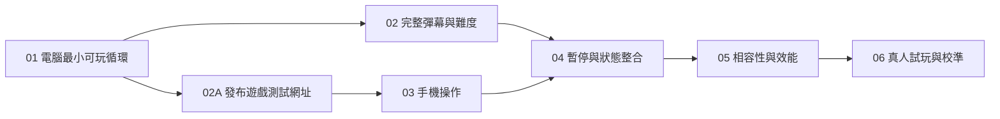

# 遊戲開發工作單規劃

狀態：拆分草案，等待確認粒度、前置依賴及工作單存放位置。日期：2026-10-31。

依據：[遊戲規格](game-spec.md)與[遊戲用語表](../GLOSSARY.md)。本文件用於審閱規劃，不是正式工作單清單，也不代表已開始實作。確認後，每張工作單須各自建立為一筆議題或一份檔案。

## 流程與範圍

採用 `ask-matt` 所指引的 `to-tickets` 流程，將現有規格拆為可展示、可驗證的完整行為。已有定稿遊戲規格，本輪直接以該規格作為拆分依據。

目前儲存庫只有規格、用語表與專案指引，沒有既有程式、測試或工具鏈可沿用。工作單系統尚未設定；遠端儲存庫為 `Davisanity-TW/kingOfFlak`，建議使用該儲存庫的 GitHub Issues，也可選本機 Markdown 工作單。正式建立前，依 `setup-matt-pocock-skills` 完成存放位置與相關設定確認。

本次規劃交付可在本機啟動及建置的單人遊戲，包含供跨裝置測試的公開網址，不包含帳號、排行榜、射擊、道具或音效。技術選型與可重現的開發指令由第一張工作單落實，不另拆一張只做架構或工具安裝的任務。

## 工作單總覽

| 編號 | 工作單 | 直接前置依賴 | 完成後可展示的成果 |
| --- | --- | --- | --- |
| 01 | 電腦版最小可玩循環 | 無 | 開始、方向鍵移動、遭子彈命中、結算及重玩。 |
| 02 | 完整追蹤彈幕與難度時間表 | 01 | 隨機生成、追蹤、反彈、100 至 300 顆及定時加速均實際影響遊戲。 |
| 02A | 發布遊戲測試網址 | 01 | 手機可透過公開 HTTPS 網址開啟遊戲，不依賴本機伺服器。 |
| 03 | 手機橫向畫面與類比搖桿 | 02A | 手機可用搖桿完成同一局遊戲，地圖不被操作區遮擋。 |
| 04 | 暫停、恢復與跨裝置狀態整合 | 02、03 | 手動暫停、失焦及轉向可安全恢復，成績與難度計時一致。 |
| 05 | Chrome／Safari 相容性與效能驗收 | 04 | 完整遊戲在指定裝置有可追溯的驗證結果，發現的問題已修正。 |
| 06 | 真人試玩與平均存活時間校準 | 05 | 有電腦、手機分開統計的試玩結果，據此驗證或調整至平均 20–30 秒。 |

01 完成後可進行 02 與 02A；02A 必須在開始 03 前完成。兩者仍共用遊戲狀態與輸入介面，實際同時實作時須協調共用部分。其餘依箭頭順序處理。本規劃不會自動啟動平行實作。

## 01：電腦版最小可玩循環

**交付行為：** 玩家能在電腦開啟遊戲、開始一局、操控飛機閃避可移動的測試子彈，碰撞後查看成績並重玩。這是可運作的第一段遊戲，不是只有靜態畫面。

**狀態：** 已完成。2026-10-31 使用者確認工單 01 全數驗證完成（MacBook／Chrome）；瀏覽器版本未提供。8 項單元測試、3 項 Chrome 瀏覽器測試、型別檢查與建置通過。實作提交：`9b061bb`；首幀凍結修正：`9477d33`。

**前置依賴：** 無。

**規格涵蓋：** Q1–Q3、Q6、Q7 的地圖與飛機參數、Q10 的鍵盤操作、Q12 的視覺，以及結算與重新開始。

**驗收條件：**

- [x] 建立必要工具鏈、格式與靜態檢查；提供相依套件安裝、本機啟動、自動化測試及正式建置的可重現指令，記錄語言、框架、進入點及實際目錄結構，排除產物與本機機密。
- [x] 800 × 600 地圖以 4:3 完整等比例顯示；深色地圖、淺色飛機、橘色圓點子彈，時間與數量位於地圖外。按鈕可使用鍵盤操作並有明確焦點與名稱。
- [x] 飛機從中央開始，輪廓約 24 × 24、最高速度每秒 240；方向鍵直接移動，上＋右可斜移且不加速，相反方向抵銷，鬆開即停，機頭固定朝上，貼牆可沿牆移動且不越界。
- [x] 先用少量可重現的移動子彈完成整個遊玩循環，明確標記為本階段開發情境；完整正式生成規則由 02 取代，不能將少量情境視為最終玩法。
- [x] 圓形子彈與可見機身、機翼接觸或相切即結束，透明角落不算；較大的單次移動跨過飛機仍可偵測命中。
- [x] 結算凍結畫面並標示致命接觸位置，只顯示死亡當下子彈數及存活秒數到小數點後一位；致命子彈計入，多顆同時命中只結算一次。
- [x] 重玩會重設位置、時間、子彈與輸入，結算後數字保持不變，沒有歷史紀錄或額外總分。
- [x] 自動化驗證斜移、鬆開、邊界、碰撞輪廓、高速穿越及結算重設；實際在瀏覽器完成一次開始至重玩的操作，附驗證結果。

**測試邊界：** 從輸入方向與經過時間驗證遊戲狀態，再以瀏覽器驗證畫面與操作是否接上同一行為。測試可控制子彈初始狀態，不需要為測試新增玩家可見選項。

## 02：完整追蹤彈幕與難度時間表

**交付行為：** 玩家面對正式的四邊隨機彈幕；子彈會追蹤及反彈，數量與速度按時間增加，並沿用既有碰撞與結算。

**前置依賴：** 01。

**規格涵蓋：** Q4–Q5、Q7–Q9、Q14、難度時間表及成績定義。

**驗收條件：**

- [ ] 開局 100 顆，每 5 秒加入 40 顆，最多 300 顆；子彈半徑 4，持續存在且彼此穿透，數量不足時只補至上限。
- [ ] 四邊隨機生成、無預警；新子彈在地圖內與牆相切，圓周離飛機輪廓至少 80 單位，初始朝向當下飛機。合法邊等機率選擇，邊內位置隨機，開局亦適用。
- [ ] 無合法出生點時跳過該次無法生成的數量，不累積補生，也不延後獨立的加速排程。
- [ ] 子彈以每秒最多 12 度逐漸轉向當下飛機，不預判；撞牆依鏡面反射、速率不變，同時撞兩面牆反轉兩個速度分量，反射方向不被追蹤立即覆蓋。
- [ ] 初速每秒 120，第 10 秒立即增為 140，之後每 5 秒增加 20，最高 300；新舊子彈都使用當下速率，生成與加速同時到期時先加速再生成。
- [ ] 沒有跳過生成時，第 10 秒為 180 顆／速度 140，第 25 秒為 300 顆／速度 200，第 50 秒為 300 顆／速度 300。超過 30 秒及達上限後都可繼續遊玩。
- [ ] 變更畫面更新率或一次跨過多個排程時點，不會漏生、重複加速或改變有效時間下的規則；重玩重設所有排程及速度。
- [ ] 自動化驗證出生安全、數量上限、加速邊界、追蹤角度、牆與角落反射，以及最高速度的碰撞；在正式玩法中展示數量、速度與結算一致。

**測試邊界：** 沿用 01 的遊戲狀態行為測試，加入可控制的時間與隨機結果；驗證玩家看得到的彈道、數量及成績，不另建通用遊戲引擎。

## 02A：發布遊戲測試網址

**交付行為：** 提供手機可直接開啟的公開 HTTPS 遊戲網址。保留既有編號，本單必須在開始工單 03 前完成。

**狀態：** 待實作。

**前置依賴：** 01；可先發布少量子彈開發情境，不必等待 02。

**驗收條件：**

- [ ] 將正式建置產物發布至靜態託管服務，交付實際 HTTPS 網址；不可用 localhost、區域網路位址或原始碼網址代替。
- [ ] 開發伺服器關閉後仍可使用，不要求手機與電腦使用相同 Wi-Fi，不使用短期開發隧道作為固定測試入口。
- [ ] 從發布網址確認頁面、程式與樣式正常載入，重新整理正常；電腦可完成開始、移動、碰撞、結算與重玩。
- [ ] 至少以一台真實手機開啟網址，記錄裝置、瀏覽器與載入結果；搖桿操作由 03 交付。
- [ ] README 記錄實際測試網址、託管方式、部署及更新指令、已發布的 Git commit。後續工單驗收前更新發布版本。
- [ ] 設定必要的資源路徑與部署流程；憑證放在服務或 CI 的機密設定，不寫入版本控制。

**外部條件：** 需要部署權限與真實手機驗證結果。未完成時不得標記完成或開始 03；實際網址於交付時填入。

## 03：手機橫向畫面與類比搖桿

**交付行為：** 玩家可在手機橫向使用左側搖桿開始、操控飛機、死亡並重玩，使用與電腦相同的地圖及規則。

**前置依賴：** 02A（已包含 01）；開始前須取得已驗證的公開測試網址。可使用少量子彈情境驗收操作，不依賴 02 的完整彈幕。

**規格涵蓋：** Q1、Q10 的手機操作、Q13 的手機版面與全螢幕降級體驗。

**驗收條件：**

- [ ] 介面填滿可用橫向畫面，4:3 地圖保持完整、不拉伸、不裁切；搖桿與資訊在地圖外，窄螢幕可縮小整張地圖，至少檢查 640 × 360 可用區域。
- [ ] 固定左側類比搖桿的中央 15% 為死區，其外線性對應 0–100% 速度，最高每秒 240；支援連續方向、鬆開即停。
- [ ] 手指移出搖桿範圍、觸控取消或第二根手指觸碰介面時，原操作不會卡住或被意外接管；遊戲操作不觸發頁面捲動。
- [ ] 開始、結算與重玩可觸控操作；搖桿有可辨識的用途說明，控制區與系統安全區不互相遮擋。
- [ ] 開始操作可觸發全螢幕請求，無法進入時仍可在橫向瀏覽器正常遊玩；直向顯示橫放提示，不開始新局。遊戲中的轉向暫停交由 04 整合。
- [ ] 自動化驗證死區、推動幅度、指標取消及輸入釋放；記錄手機版面與觸控操作證據，真實裝置的完整矩陣由 05 補齊。

**測試邊界：** 輸入結果應接入 01 既有的移動行為；以瀏覽器指標事件驗證搖桿，再以可取得的實機補充操作證據，模擬結果須明確標記。

## 04：暫停、恢復與跨裝置狀態整合

**交付行為：** 完整彈幕在電腦與手機皆能安全暫停、恢復、結算與重玩；離開畫面或旋轉手機不會讓玩家在無法操作時死亡。

**前置依賴：** 02、03；需同時整合生成與加速排程、鍵盤及觸控。

**規格涵蓋：** Q11、遊戲流程與狀態、成績定義。

**驗收條件：**

- [ ] 開始按下後直接開局；Esc 或暫停按鈕可暫停，手機也有可觸控的暫停按鈕。
- [ ] 失焦、切換分頁或手機轉直向時自動暫停；位置、子彈、生成、加速與存活時間全部凍結，清除鍵盤及搖桿殘留輸入。
- [ ] 使用者主動繼續後倒數 3 秒，倒數期間維持凍結；再次失焦或轉直向時返回暫停，下次繼續重新倒數。
- [ ] 恢復時不補生子彈、不補算加速，存活秒數排除暫停與倒數；在 5 秒生成、10 秒加速等邊界前後暫停仍恰好執行一次事件。
- [ ] 只允許有效的狀態操作，結算後繼續或舊倒數不會重新啟動遊戲；重玩使所有排程、速度與輸入回到初始狀態。
- [ ] 在完整 100 至 300 顆彈幕下，用鍵盤與搖桿分別完成開始、暫停、恢復、死亡及重玩，成績與死亡瞬間一致。
- [ ] 以自動化行為測試覆蓋上述狀態轉移與時間邊界，補充瀏覽器失焦及橫直向操作驗證。

## 05：Chrome／Safari 相容性與效能驗收

**交付行為：** 玩家在規格指定的瀏覽器與裝置上可完整遊玩，且滿量最高速時仍維持可操作性。此單包含發現問題的修正與回歸驗證。

**前置依賴：** 04；02 與 03 已透過 04 間接完成，無須重複列為直接依賴。

**規格涵蓋：** Q13 及所有玩法的跨瀏覽器整合驗證。

**驗收條件：**

- [ ] 驗證 Windows／macOS Chrome、macOS Safari、Android Chrome、iPhone Chrome 與 Safari；逐項記錄實際裝置、作業系統、瀏覽器版本及結果。
- [ ] 每種組合至少完成開始、移動、碰撞、暫停／恢復、結算及重玩；手機另驗證觸控取消、橫直向及全螢幕無法使用時的體驗。
- [ ] 實測 300 顆、速度每秒 300 的場景連續運作 10 分鐘，目標每秒 60 幀；記錄平均幀率、明顯卡頓與測試裝置，而非只宣稱「順暢」。
- [ ] 高速及短暫卡頓下仍無穿牆、穿越飛機漏判、重複排程或結算錯誤；壓測用的存活延長機制只用於測試，不混入正式遊戲。
- [ ] 畫面、操作區、焦點與文字在目標尺寸可辨識；修正實測問題後執行相關回歸檢查，留下畫面或操作證據。
- [ ] 安裝、檢查、測試與正式建置指令可重現；記錄驗證結果及尚未取得的裝置。任何缺測組合都標示待驗證，不能將模擬器或其他引擎結果當成該實機已通過。

**外部條件：** 需要取得指定真實裝置。無法取得時，先完成可驗證項目並留下明確缺口，此單維持未完成。

## 06：真人試玩與平均存活時間校準

**交付行為：** 以真實玩家資料驗證電腦及手機各自平均存活約 20–30 秒，必要時調整遊戲難度並重測，保留高手繼續生存的空間。

**前置依賴：** 05；在已驗證的裝置上進行，避免把效能或輸入缺陷誤認為玩法難度。

**規格涵蓋：** 平衡目標與試玩驗收、平均存活秒數、驗收情境 17–18。

**驗收條件：**

- [ ] 準備人工可填寫的試玩紀錄，包含版本、裝置、操作方式、是否練習局、有效存活秒數、死亡子彈數與死亡原因；不新增線上追蹤或玩家帳號。
- [ ] 依規格建議，以一局練習後的一般玩家為對象，每種操作方式至少 5 位、每位 5 局正式試玩；記錄實際樣本及限制。
- [ ] 電腦、手機分開計算算術平均、中位數、最短及最長存活時間；正常早死與長局均納入，技術故障中斷另行記錄。
- [ ] 先排查碰撞、輸入、計時、效能與出生安全問題，再決定是否調整轉向速率、尺寸或飛機速度；一次調整一項，保留前後參數與試玩結果。
- [ ] 改動已定稿的數量或加速規則時同步修訂規格與驗收值；不可用強制死亡、隱藏時限或暗中變更碰撞來達成平均值。
- [ ] 提供兩種操作方式平均約 20–30 秒的實測證據，且超過 30 秒仍可繼續遊玩；若未達標，清楚列出偏差及下一步，此單不標記完成。
- [ ] 調整後相關自動化測試通過；若影響效能、版面或裝置操作，重跑受影響的相容性驗證。

**外部條件：** 需要真人試玩者與回傳資料。程式代理可準備紀錄、分析與調整，但不能以自動操作或編造數據代替真人結果；樣本不足時維持待試玩。

## 規格覆蓋檢查

| 遊戲規格的驗收情境編號 | 主要工作單 |
| --- | --- |
| 1、4、8、9、11、12 | 01；02、04 延伸完整規則的回歸測試。 |
| 2、3 | 03；01 提供共同地圖。 |
| 5、6、7、13、14、15、18 | 02。 |
| 10、16 | 04。 |
| 17 | 06。 |
| 跨瀏覽器、手機實機與效能 | 05。 |

## 完成與交接

每張工作單均附本張的驗證證據；修正錯誤時補上可重現的回歸檢查。沿用專案語言與自動提交規則，完成且通過驗證後建立聚焦的英文本機提交；推送或公開發布另依使用者指示。

正式工作單各自保留交付行為、驗收條件與直接依賴。GitHub 方式使用實際議題編號及可用的原生阻擋關係；本機方式每張各自存放並記錄編號依賴。真人及實機驗證的外部條件須保留，不能只因程式完成就結案。

## 待確認

1. 是否採用這 7 張的粒度與依賴；若要合併或再拆分，指定編號即可。
2. 工作單存放於 GitHub Issues（建議，目標為 `Davisanity-TW/kingOfFlak`）或本機 Markdown。選定後再依設定流程提供設定草案並正式建立工作單。
